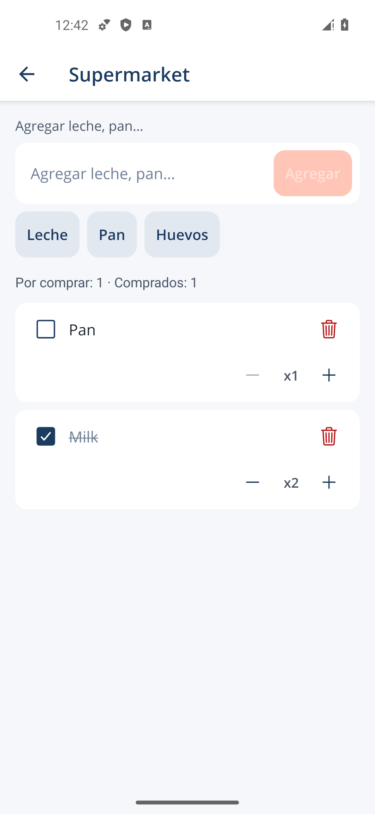
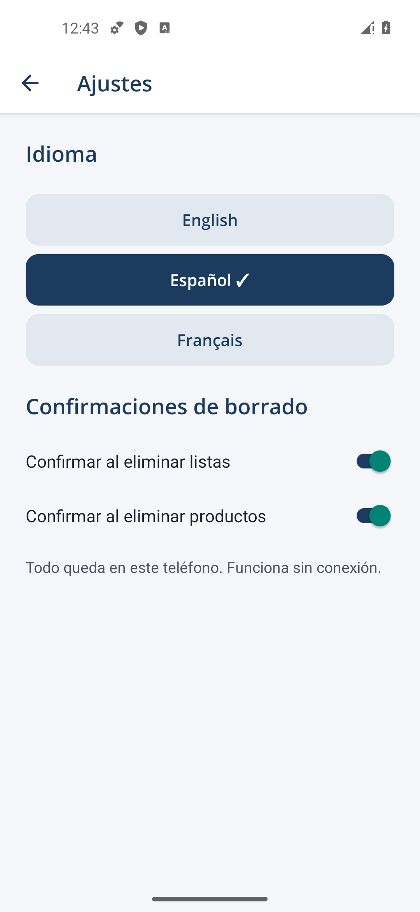

# MesCourses+

Aplicación Android para organizar listas de compras, desarrollada con **React Native + TypeScript**, **SQLite** y **Zustand**.

Funciona completamente offline: las listas, los productos y los ajustes se guardan en el teléfono. Esta primera versión reemplaza la implementación .NET MAUI y conserva su comportamiento principal y su identidad visual azul/coral.

## Estado del proyecto

Primera base funcional, compilada y probada en un emulador Android. Preparada para continuar mejorando la experiencia y añadir nuevas capacidades mediante servicios separados.

### Funciones disponibles

- Crear, abrir, renombrar y eliminar listas de compras.
- Añadir productos mediante texto o sugerencias traducidas.
- Cambiar cantidades, con un mínimo de una unidad.
- Marcar productos como comprados: se tachan y pasan al final.
- Editar nombres con doble toque o pulsación prolongada.
- Confirmar borrados, con preferencias independientes para listas y productos.
- Cambiar entre español, francés e inglés. El idioma inicial sigue al dispositivo.
- Conservar los datos y ajustes al cerrar y volver a abrir la app, sin conexión.

### Pantallas

| Listas                                                                      | Compras                                                                                      | Ajustes                                                                             |
| --------------------------------------------------------------------------- | -------------------------------------------------------------------------------------------- | ----------------------------------------------------------------------------------- |
|  |  |  |

## Stack

| Parte         | Tecnología                                               |
| ------------- | -------------------------------------------------------- |
| Aplicación    | React Native 0.86 / Expo SDK 57                          |
| Lenguaje      | TypeScript con comprobación estricta                     |
| Navegación    | Expo Router, stack nativo                                |
| Persistencia  | SQLite local, mediante expo-sqlite                       |
| Estado global | Zustand                                                  |
| Pruebas       | Jest, React Native Testing Library y SQLite real de Node |

SQLite es la fuente de verdad. Los repositorios contienen el SQL; las acciones del store coordinan las operaciones y actualizan la interfaz después de guardar.

## Requisitos

- Node.js 24 y npm.
- JDK 17.
- Android SDK, herramientas de plataforma y un emulador o teléfono Android.
- CMake 3.31.6 del Android SDK para la configuración nativa del proyecto.

Android Studio facilita instalar estas herramientas, pero no es obligatorio si ya están instaladas. Las carpetas nativas se generan con Expo y no se mantienen manualmente.

## Instalar y ejecutar

```powershell
git clone https://github.com/MannyDevFr/MesCourses.git
cd MesCourses
npm ci
npm run android
```

`npm run android` compila e instala la versión de desarrollo y arranca Metro. El primer build puede tardar mientras se descargan las herramientas y dependencias nativas.

Para arrancar únicamente el servidor de desarrollo:

```powershell
npm start
```

### Probar desde la PC

Podés usar un emulador Android con el mouse y el teclado. En Android Studio, abrí **Device Manager** e iniciá un dispositivo virtual.

En la PC donde se desarrolló esta base, el emulador está instalado y también puede abrirse directamente desde PowerShell:

```powershell
& 'C:\Program Files (x86)\Android\android-sdk\emulator\emulator.exe' -avd 'pixel_5_-_api_34' -gpu swiftshader_indirect
```

Después abrí **MesCourses+** dentro del emulador. Una versión standalone ya instalada funciona sin Metro y sin conexión.

### Compilar un APK standalone

```powershell
npm run apk
```

El APK se genera en `android/app/build/outputs/apk/release/app-release.apk`.

Para limitar el build a teléfonos de 64 bits y al emulador de esta PC:

```powershell
$env:ORG_GRADLE_PROJECT_reactNativeArchitectures = 'arm64-v8a,x86_64'
npm run apk
```

Para compilar solo para el emulador x86_64:

```powershell
npm run apk -- --emulator-only
```

En Windows, el lanzador detecta el SDK y crea una unión local `.android-sdk` para evitar problemas con espacios en las rutas del NDK. Si el SDK está en otra ubicación, configurá `ANDROID_HOME`. El plugin selecciona CMake 3.31.6 y Ninja compatible con rutas largas.

El APK actual utiliza una clave de desarrollo. Antes de publicarlo en una tienda hay que configurar una firma de producción privada.

Para regenerar Android después de cambiar la configuración nativa:

```powershell
npx expo prebuild --platform android
```

## Arquitectura

```text
src/
├── app/            # Rutas y navegación
├── bootstrap/      # Inicialización, fuentes y estados de arranque
├── screens/        # Listas, detalle y ajustes
├── components/     # Productos, entrada rápida y componentes comunes
├── models/         # Modelos de dominio tipados
├── stores/         # Estado y acciones de la aplicación
├── database/       # Conexión, esquema y migraciones
├── repositories/   # Acceso a SQLite
├── services/       # Límites para futuras integraciones
├── hooks/          # Traducciones y confirmaciones
├── constants/      # Colores y textos
└── utils/          # Validación
```

La base de datos incorpora migraciones versionadas, claves foráneas, borrado en cascada, restricciones y consultas parametrizadas. Los estados de edición y los diálogos permanecen en los componentes.

El [mapa de migración](docs/MIGRATION.md) explica las correspondencias funcionales y las decisiones de arquitectura. La aplicación nueva puede ejecutarse sin disponer del proyecto MAUI.

## Pruebas y validación

```powershell
npm run check
npx expo-doctor
npm run build:android
```

- `check`: lint, TypeScript y pruebas automatizadas.
- `expo-doctor`: compatibilidad de configuración y dependencias.
- `build:android`: exporta JavaScript y recursos; no compila un APK.

La base se entregó con **8 pruebas pasando en 3 suites**, **21/21 comprobaciones de Expo Doctor** y un APK probado en Pixel 5 / Android 14.

Las pruebas de datos usan SQLite real y verifican persistencia, restricciones, orden y borrado en cascada. Las pruebas de componentes cubren entrada de productos, cantidades, edición y confirmaciones. Además, se comprobó el funcionamiento offline, el reinicio, los ajustes y el botón Atrás en Android.

Ver [resultados de validación](docs/VALIDATION.md). La ergonomía en teléfonos físicos, tamaños de fuente grandes y accesibilidad requieren revisión adicional.

## Evolución prevista

La arquitectura deja límites definidos para voz, IA, OCR y sincronización cloud. Estas funciones todavía no están implementadas ni requieren cuentas o servicios externos. Ver [futuras integraciones](src/services/README.md).

Los datos de instalaciones MAUI anteriores no se importan automáticamente. Esta versión crea su propia base SQLite local.

## Dependencias y recursos

El [informe de auditoría](docs/dependency-audit.json) registra alertas pendientes en el árbol de dependencias del SDK y las herramientas. No se aplicaron cambios incompatibles mediante `npm audit fix --force`; su aplicabilidad debe revisarse antes de distribuir la aplicación en producción.

El icono y las fuentes Open Sans provienen del proyecto original. Ver [procedencia de recursos](assets/NOTICE.md). El archivo LICENSE procede de la plantilla Expo.

Los APK locales, SDK, dependencias instaladas y carpetas nativas generadas están excluidos de Git.
